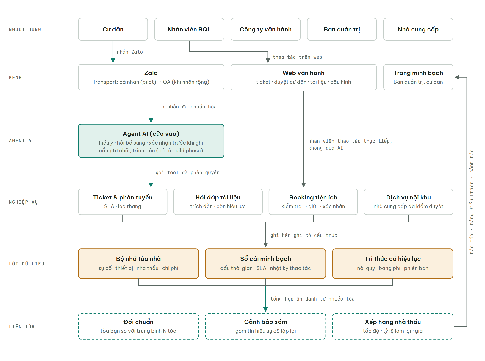
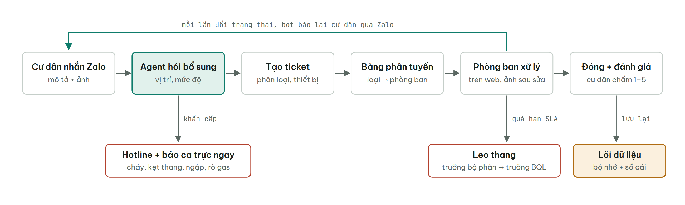
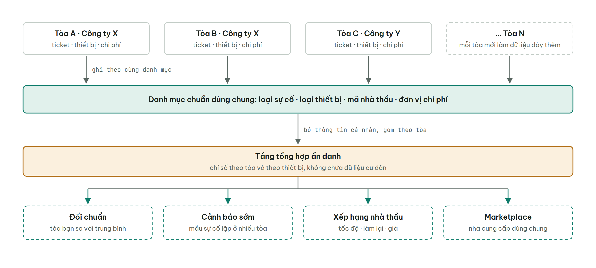
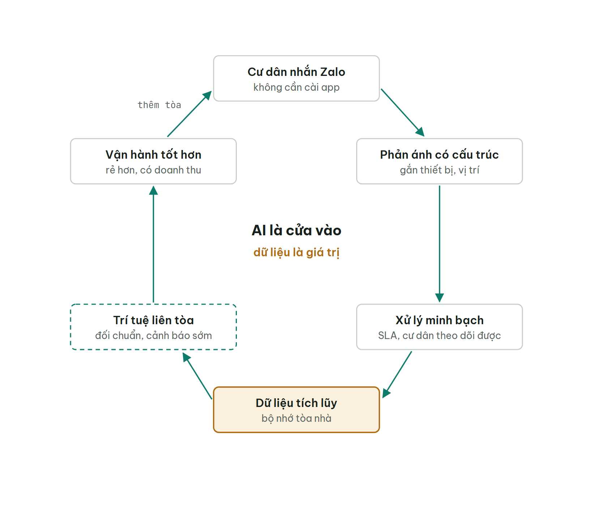
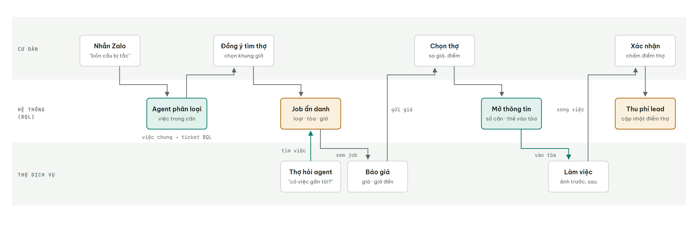
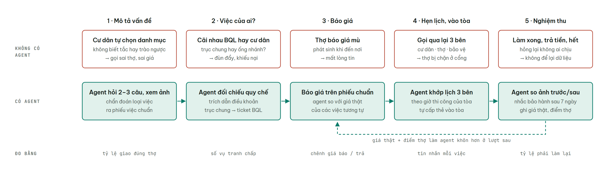
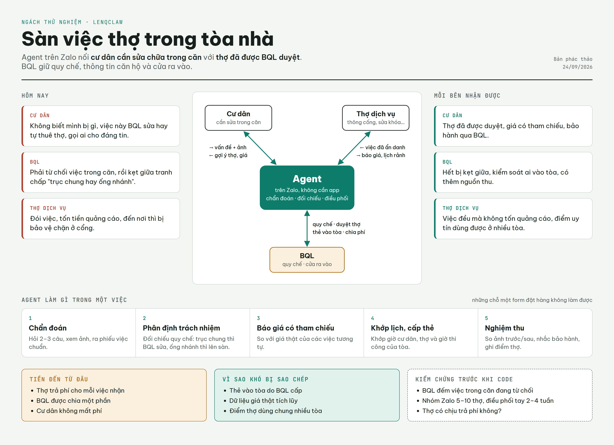
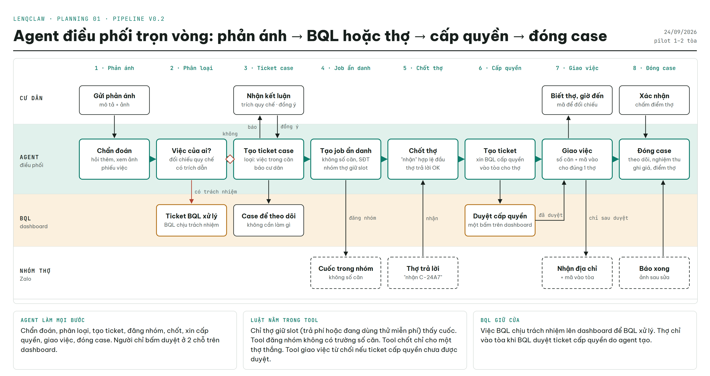
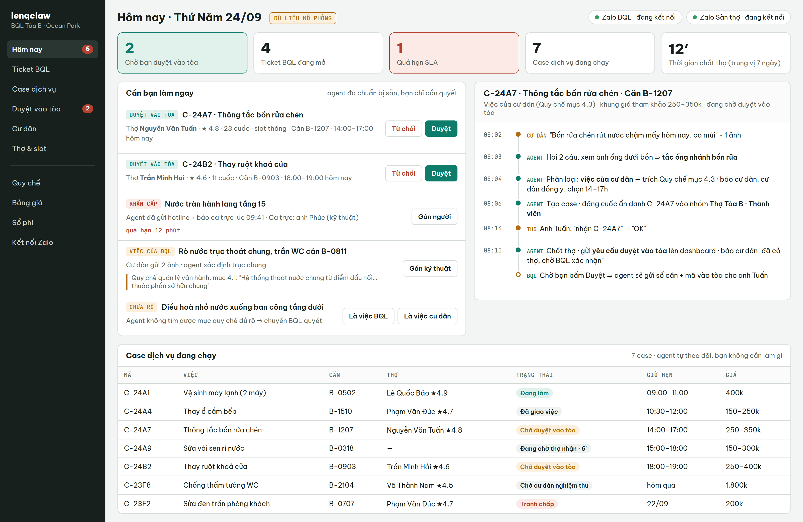
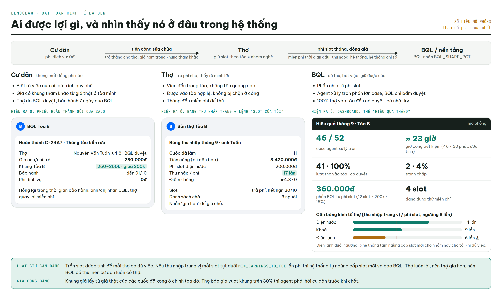

# Bản đồ hệ thống lenqclaw

> Sơ đồ tổng quan v0.2 — 2026-09-24. AI là cửa vào để dữ liệu chảy vào hệ thống; giá trị nằm ở dữ liệu vận hành tích lũy và nhân lên khi có nhiều tòa.

## 1. Kiến trúc 6 tầng



Cư dân đi qua Agent AI. Nhân viên thao tác thẳng trên web, không qua AI. Mọi nghiệp vụ ghi vào lõi dữ liệu; lõi dữ liệu nuôi tầng liên tòa; báo cáo đi ngược lên cho Ban quản trị và công ty vận hành.

```text
┌─ NGƯỜI DÙNG ───────────────────────────────────────────────────────────────────────┐
│ Cư dân  ·  Nhân viên BQL  ·  Công ty vận hành  ·  Ban quản trị  ·  Nhà cung cấp    │
└─────┬─────────────────────┬─────────────────────────────────┬──────────────────────┘
      │ nhắn Zalo           │ thao tác web                    ▲ báo cáo · cảnh báo
      ▼                     ▼                                 │
┌─ KÊNH ──────────────────────────────────────────────────────┴──────────────────────┐
│ Zalo · Transport    Web vận hành                Dashboard · Trang minh bạch        │
│ cá nhân → OA        phòng ban dùng              Ban quản trị, Cty vận hành         │
└─────┬─────────────────────┬─────────────────────────────────┬──────────────────────┘
      │ tin chuẩn hóa       │ không qua AI                    ▲ báo cáo
      ▼                     │                                 │
┌─ AGENT AI ──────────────┐ │                                 │
│ hiểu ý · hỏi bổ sung    │ │                                 │
│ xác nhận trước khi ghi  │ │                                 │
│ cổng từ chối, trích dẫn │ │                                 │
└─────┬───────────────────┘ │                                 │
      │ gọi tool            │                                 │
      │ có phân quyền       │                                 │
      ▼                     ▼                                 │
┌─ NGHIỆP VỤ ────────────────────────────────────────────┐    │
│ Ticket & phân tuyến (SLA)  ·  Hỏi đáp tài liệu         │    │
│ Booking tiện ích           ·  Dịch vụ nội khu          │    │
└───────────────────────────┬────────────────────────────┘    │
                            │ ghi bản ghi có cấu trúc         │
                            ▼                                 │
╔═ LÕI DỮ LIỆU · mất là đau ═════════════════════════════╗    │
║ Bộ nhớ tòa nhà: sự cố · thiết bị · nhà thầu · chi phí  ║    │
║ Sổ cái minh bạch: thời gian · SLA · nhật ký thao tác   ║    │
║ Tri thức có hiệu lực: nội quy · bảng phí · phiên bản   ║    │
╚═══════════════════════════╤════════════════════════════╝    │
                            │ tổng hợp ẩn danh, nhiều tòa     │
                            ▼                                 │
┌╌ LIÊN TÒA · chỉ có khi nhân rộng ╌╌╌╌╌╌╌╌╌╌╌╌╌╌╌╌╌╌╌╌╌╌┐    │
╎ Đối chuẩn · Cảnh báo sớm · Xếp hạng nhà thầu           ╎────┘
╎ Marketplace dịch vụ nội khu                            ╎
└╌╌╌╌╌╌╌╌╌╌╌╌╌╌╌╌╌╌╌╌╌╌╌╌╌╌╌╌╌╌╌╌╌╌╌╌╌╌╌╌╌╌╌╌╌╌╌╌╌╌╌╌╌╌╌╌┘
```

## 2. Một phản ánh đi qua hệ thống



```text
1. Cư dân nhắn Zalo (mô tả + ảnh)
   │
2. Agent hỏi bổ sung: vị trí, mức độ ──── khẩn cấp? ───► Hotline + báo ca trực ngay
   │  → tóm tắt, cư dân bấm xác nhận
3. Tạo ticket: phân loại, gắn thiết bị
   │
4. Bảng phân tuyến (BQL cấu hình): loại sự cố → phòng ban
   │
5. Phòng ban xử lý trên web ────────── quá hạn SLA? ───► Leo thang: trưởng bộ phận → trưởng BQL
   │  └─ mỗi lần đổi trạng thái ───► bot báo lại cư dân qua Zalo
6. Đóng ticket + cư dân chấm 1–5
   │
   ▼
╔═ Lõi dữ liệu: bộ nhớ tòa nhà + sổ cái ═╗
```

Bảng phân tuyến nằm trong database, BQL cấu hình. AI không tự chọn phòng ban. Khẩn cấp đi thẳng tới ca trực.

## 3. Vì sao nhiều tòa tạo giá trị mà một tòa không có



```text
  Tòa A · Cty X     Tòa B · Cty X     Tòa C · Cty Y       … Tòa N
        │                 │                 │                 │
        └─────────────────┴────────┬────────┴─────────────────┘
                                   │ ghi theo CÙNG một danh mục
                                   ▼
    Danh mục chuẩn: loại sự cố · loại thiết bị · mã nhà thầu · chi phí
                                   │ bỏ dữ liệu cá nhân, gom theo tòa
                                   ▼
                    ╔══ Tầng tổng hợp ẩn danh ══╗
                                   │
        ┌─────────────────┬────────┴────────┬─────────────────┐
        ▼                 ▼                 ▼                 ▼
   Đối chuẩn         Cảnh báo sớm      Xếp hạng          Marketplace
   tòa bạn vs TB     sự cố lặp lại     nhà thầu          dịch vụ nội khu
```

Danh mục chuẩn phải có từ ngày đầu. Mô hình dữ liệu phân cấp: tổ chức → dự án → tòa → căn · thiết bị, kể cả khi mới chạy 1 tòa.

## 4. Vòng quay dữ liệu



```text
      ┌──►  Cư dân nhắn Zalo  ──►  Phản ánh có cấu trúc  ──┐
      │                                                    ▼
 Thêm tòa tham gia                                Xử lý minh bạch, có SLA
      ▲                                                    │
      │                                                    ▼
 Vận hành rẻ hơn  ◄──  Trí tuệ liên tòa  ◄──  Dữ liệu tích lũy
 + doanh thu dịch vụ      (đối chuẩn, cảnh báo)   (bộ nhớ tòa nhà)
```

## 5. Khi có và khi mất

| Bên | Khi có | Khi mất |
|---|---|---|
| Cư dân | Nhắn Zalo là xong, theo dõi được tiến độ, có thợ đáng tin | Nhắn vào hư không, không biết ai đang xử lý |
| Nhân viên BQL | Có bộ nhớ, có bằng chứng mình đã làm | Mất lịch sử, bị đổ lỗi không có gì chứng minh |
| Công ty vận hành | Dashboard nhiều tòa, đối chuẩn, doanh thu dịch vụ, bằng chứng giữ hợp đồng | Quản lý cảm tính, mất nguồn thu, rủi ro bị thay |
| Ban quản trị | Báo cáo minh bạch cho hội nghị nhà chung cư | Chỉ nghe lời kể từ hai phía |
| Chủ đầu tư | Dữ liệu lỗi bàn giao, bảo hành có cấu trúc | Tranh chấp bảo hành không có dữ liệu |

## 6. Lộ trình

| Giai đoạn | Quy mô | Xây gì | Đo gì |
|---|---|---|---|
| 1 · Pilot | 1–2 tòa | Zalo cá nhân qua Transport · ticket & phân tuyến · hỏi đáp · booking · web vận hành | Thời gian phản hồi đầu, tỷ lệ tự giải quyết, ticket quá hạn, điểm đánh giá |
| 2 | 5–10 tòa, 1 công ty | Thêm Zalo OA · danh mục thiết bị, chi phí, nhà thầu · dashboard nhiều tòa · trang minh bạch | Chênh lệch hiệu suất giữa các tòa, chi phí bảo trì mỗi tòa |
| 3 | 20+ tòa, nhiều công ty | Đối chuẩn · cảnh báo sớm · xếp hạng nhà thầu · marketplace dịch vụ | Sự cố phát hiện sớm, doanh thu dịch vụ, tỷ lệ gia hạn hợp đồng |

**Có sẵn từ build phase (Resident Agent v1.0):** cổng từ chối khi nguồn thiếu/mâu thuẫn/hết hiệu lực · trích dẫn tới từng mục · lớp hành động kiểm tra → ghi → biên nhận → hoàn tác · hàng đợi duyệt câu trả lời · console tài liệu BQL · bộ eval Golden.

## 7. Ngách thử nghiệm: sàn việc cho thợ dịch vụ (đang đánh giá)



Agent cư dân tạo ra việc, agent thợ tìm việc, còn BQL giữ hai thứ: thông tin căn hộ (chỉ mở khi cư dân đã chọn thợ) và quyền ra vào tòa. Nguồn việc là **việc trong căn** mà BQL hiện đang từ chối, không phải ticket khu vực chung.

## 8. Agent tạo giá trị ở đâu (so với form/app)



Phép thử: bước nào thay agent bằng một form mà vẫn chạy tốt thì bước đó không cần agent. Agent chỉ đáng tiền ở những chỗ đầu vào mơ hồ, phải đối chiếu quy chế, hoặc phải điều phối nhiều bên.

## 9. Ảnh tổng quan ngách "Sàn việc thợ trong tòa nhà" (để chia sẻ)



## 10. Pipeline chuẩn v0.2 — agent điều phối trọn vòng (hồ sơ planning 01, Đ10)



Chi tiết từng bước, bất biến và hợp đồng: [`planning/01_2026-09-24_san-viec-tho-mvp/`](../planning/01_2026-09-24_san-viec-tho-mvp/plan.md).

Bản ký tự (đã được người dùng duyệt 2026-09-24):

```text
CƯ DÂN            AGENT (điều phối mọi bước)              BQL (dashboard)       NHÓM THỢ (Zalo)
──────────────    ──────────────────────────────          ────────────────      ─────────────────
Gửi phản ánh ───► 1. Chẩn đoán: hỏi thêm, ảnh
                     │
                  2. Việc của ai? (quy chế) ──── có ────► Ticket BQL xử lý
                     │ không
Nhận kết luận ◄── 3. Tạo ticket case ───────────────────► Case theo dõi
Đồng ý ─────────────►│
                  4. Tạo job ẩn danh ───────────── nhóm giữ slot ─────────────► Cuốc (ẩn số căn)
                     │
                  5. Chốt thợ ◄──────────────────── nhận ────────────────────── "nhận C-24A7" + OK
                     │
                  6. Xin cấp quyền vào tòa ─────────────► Duyệt cấp quyền
                     │  ◄──────── đã duyệt ─────────────────────┘
Biết thợ, giờ ◄── 7. Giao việc ─────────────── số căn + mã vào ───────────────► Nhận địa chỉ, mã
                     │
Xác nhận, chấm ─► 8. Đóng case: giá, điểm thợ ◄─────── báo xong + ảnh ───────── Làm xong
```


## 11. Dashboard BQL (mockup, Đ11)



Dữ liệu mô phỏng. UI còn rối mắt — tinh gọn sau.

## 12. Kinh tế ba bên hiện trong hệ thống (Đ15)



Cư dân 0đ phí, trả tiền công thẳng cho thợ · thợ đóng phí slot tháng đồng giá (miễn phí thời gian đầu) · BQL nhận phần chia. Luật cân bằng: thu nhập trung vị mỗi slot dưới `MIN_EARNINGS_TO_FEE` lần phí ⇒ ngừng cấp slot mới.
