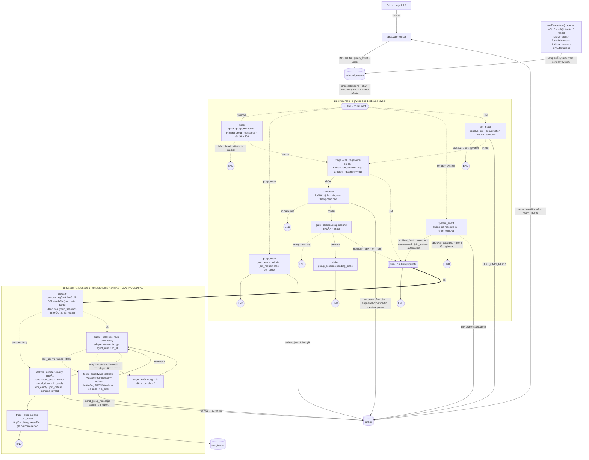

Vai: worker (vai-thi-cong) · loại: thi công (architect — chỉ ghi SPEC + evidence, KHÔNG mã) · họ/model: Claude / Opus 5.5 (🔴) · Bước 0: exit 0 · hiểu việc: thiết kế lại runtime agent thành đồ thị LangGraph trong bộ SPEC (00 §4–§7, 01 contracts, P03 §2/§6/§11, chỗ gọi lượt ở P04–P08/TESTING/OPERATIONS), đo phiên bản + spike ngoài repo / xong khi `runCommunityTurn` chỉ còn trong câu "thay bởi D28", Mermaid §4 có đủ ingest·moderation·gate·agent·tools·mustReply/fallback·outbox·trace, spike exit 0, phiên bản pin chính xác / cấm đụng mã, package.json, plan.md, brain4agent/, R02/R03, evidence/P02*, cấm npm install trong repo, không push.
Handoff: handoffs/H04_kien-truc_LangGraph.md
Base: e53133d
Head: 88e3a52

> Ghi chú truy vết (SO đã xác nhận, KHÔNG viết lại lịch sử): toàn bộ phần SPEC + `evidence/ARCH-D28/{versions,spike}.txt` của gói này nằm trong `88e3a52` — commit do worker P02-fix song song tạo khi index đang chứa file tôi đã stage, nên mang message sai "add R05 report and P02-fix evidence for D29 rework" (worker đó commit lại file của họ ở `a4c6dd4`). Phần sau (report này + `evidence/ARCH-D28/diff-stat.txt`) ở commit report của tôi.

## 1. Lệnh + exit code (nguyên văn)
| Bước | Lệnh | Exit | Evidence |
| :-- | :-- | :-- | :-- |
| Bước 0 | `node --preserve-symlinks-main ../brain4agent.release/.agents/skills/.xay-dung-nao-bo/scripts/init_brain.js --check` | 0 | (stdout phiên: "NÃO ĐÃ OK") |
| a | `npm view <gói> version time --json` × 7 gói (`@langchain/langgraph`, `core`, `langgraph-checkpoint`, `-checkpoint-postgres`, `-sdk`, `langsmith`, `zod`) + `npm view …@ver dependencies` | 0 | [versions](../evidence/ARCH-D28/versions.txt) |
| a | `node src/audit-versions.mjs package-lock.json` (MỌI gói trong cây cài spike vs ngày phát hành, mốc now−14d) | 0 (`too_new=0`, 45 gói) | [versions](../evidence/ARCH-D28/versions.txt) |
| b | `npx tsc -p tsconfig.json` (strict, NodeNext — như `tsconfig.base.json`) | 0 | [spike](../evidence/ARCH-D28/spike.txt) |
| b | `node22 dist/spike.js` (Node v22.20.0, model giả, 0 mạng) | 0 (18/18 PASS) | [spike](../evidence/ARCH-D28/spike.txt) |
| b | `node22 dist/checkpoint-probe.js` (PostgresSaver trên DB tạm `lg_spike`, xoá sau; `pg_database` còn 0) | 0 (3/3) | [spike](../evidence/ARCH-D28/spike.txt) |
| b | `node22 dist/tracing-probe.js off` / `on` | 0 / 0 (off: 0 gọi mạng; on: 2 gọi `/info`, `/runs/multipart`) | [spike](../evidence/ARCH-D28/spike.txt) |
| c | `node22 dist/shape-probe.js specs/01-CONTRACTS.md` (dựng 2 đồ thị từ hằng SHAPE §12.4 bằng LangGraph thật, so `getGraph()`) | 0 (4/4, gồm 2 ca đỏ) | [spike](../evidence/ARCH-D28/spike.txt) |
| c | `node22 src/mermaid-vs-shape.mjs 00-ARCHITECTURE.md 01-CONTRACTS.md` / ca đỏ (sơ đồ sửa `NUDGE --> DEL`) | 0 / 1 (đúng kỳ vọng) | [spike](../evidence/ARCH-D28/spike.txt) |
| c | `node22 parse.mjs specs/*.md` (mermaid 12.0.0 parse; ca đỏ tự thử: block hỏng ⇒ FAIL) | 0 | [spike](../evidence/ARCH-D28/spike.txt) |
| d | `grep -n "runCommunityTurn" specs/*.md \| grep -vc "thay bởi D28"` | `0` (4 dòng còn lại đều trong câu "thay bởi D28") | — |

## 2. Test tổng/pass/fail/skip
Không chạy `npm run gate`/`npm test` của repo — theo chỉ thị SO (cây đang có agent thẩm định sửa mã tạm, kết quả lẫn đột biến); gói chỉ đổi `.md` + evidence. Bộ đo spike (ngoài repo): 18 + 3 + 2 + 4 + 2 = 29 PASS / 0 FAIL / 0 skip; 3 ca đỏ đỏ đúng chiều.

## 3. `git diff --stat <Base>..<Head>` + SHA từng commit
[diff-stat](../evidence/ARCH-D28/diff-stat.txt) · `88e3a52` (message sai, xem ghi chú đầu) 11 file, +799/−101: specs 00, 01, P03, P04, P05, P06, P07, TESTING, OPERATIONS + evidence `versions.txt`, `spike.txt` · commit report: `docs(plan-02): add R04 architect report for D28 LangGraph specs` (report + `diff-stat.txt`). Không file nào ngoài phạm vi H04 §2.

## 4. Bảng phân công thực tế
| Gói | Tầng yêu cầu | Họ/model đã dùng |
| :-- | :-- | :-- |
| a — đo + pin phiên bản | 🔴 | Claude / Opus 5.5 (tự làm) |
| b — spike LangGraph (Node 22, Postgres tạm) | 🔴 | Claude / Opus 5.5 (tự làm) |
| c — sửa bộ SPEC + sơ đồ | 🔴 | Claude / Opus 5.5 (tự làm) |
| thẩm định nội bộ (parse Mermaid, sơ đồ == SHAPE, SHAPE dựng được) | 🔴 | Claude / Opus 5.5 — có ca đỏ cho từng bộ đo |

## Phiên bản đã pin (01-CONTRACTS §12.1)
`@langchain/langgraph` **1.4.18** (phát hành 2026-09-25, 21 ngày) · `@langchain/core` **1.2.14** (2026-10-01, 15 ngày, peer). `overrides` gốc: `@langchain/langgraph-checkpoint` 1.1.5 · `@langchain/langgraph-sdk` 1.12.0 (+ `p-queue` 9.3.3) · `langsmith` 0.10.7 · `zod` 4.6.5. Bỏ 1.5.0 (latest, 2026-10-12 — 4 ngày). KHÔNG cài `@langchain/langgraph-checkpoint-postgres` trong repo.

## Sơ đồ pipeline (chép nguyên văn 00-ARCH §4.1)


### Bản ASCII (00-ARCH §4.2)
```text
Zalo (zca-js 2.2.0) ─listener─► apps/zalo-worker ─INSERT─► [inbound_events] ◄─enqueueSystemEvent(sender='system')─ runTimers(now)
                                                                │                (SQL thuần, 0 model: flushAmbient · flushWelcomes ·
                                                                │                 pickUnanswered · runAutomations)
                              processInbound (nhận-trước-xử-lý-sau, 1 runner) ▼
┌─ pipelineGraph (1 invoke / 1 inbound_event; ┄► = cạnh điều kiện THUẦN) ─────────────────────────────────────────────────┐
│ START ┄routeEvent┄┬┄ tin nhóm ┄► ingest ┄┬┄ nhóm chưa khai/tắt · tin bot ┄► END                                           │
│                   │                      └┄► triage ┄┬┄ nhóm ┄► moderate ┄┬┄ tin đã xoá ┄► END                            │
│                   │                                  │                    └┄► gate ┄┬┄ không kích hoạt ┄► END              │
│                   │                                  │                              ├┄ ambient ┄► defer ─► END            │
│                   │                                  │                              └┄ mention/reply/tên/lệnh ┄► turn     │
│                   │                                  └┄ DM ┄► turn                                                          │
│                   ├┄ group_event ┄► group_event ─► END                                                                      │
│                   ├┄ sender=system ┄► system_event ┄┬┄ ambient_flush/welcome/unanswered/join_review/automation ┄► turn    │
│                   │                                 └┄ approval_executed · nhóm tắt · giả mạo ┄► END                         │
│                   └┄ DM ┄► dm_intake ┄┬┄ takeover · unsupported ┄► END                                                     │
│                                       └┄ tin chữ ┄► triage (như trên, nhánh DM)                                            │
│ turn ─► END            (turn = runTurn(request) ⇒ turnGraph bên dưới)                                                      │
└──────────────────────────────────────────────────────────────────────────────────────────────────────────────────────────┘
┌─ turnGraph (1 lượt; recursionLimit = 2×MAX_TOOL_ROUNDS + 11) ─────────────────────────────────────────────────────────────┐
│ START ─► prepare ┄┬┄ persona hỏng ┄► deliver                                                                                │
│                   └┄ ok ┄► agent ┄┬┄ tool_use ∧ rounds < trần ┄► tools ─(rounds+1)─► agent                                │
│                                   ├┄ mustReply ∧ chưa nói ∧ không text ∧ chưa nhắc ┄► nudge ─(trần = rounds+2)─► agent    │
│                                   └┄ xong · model sập · refusal · chạm trần ┄► deliver ─► trace ─► END                    │
└──────────────────────────────────────────────────────────────────────────────────────────────────────────────────────────┘
Ghi outbox (chỉ qua enqueue()/enqueueAction() — BB-02, BB-15): moderate · group_event · system_event · dm_intake (TEXT_ONLY_REPLY)
  · tools · deliver.  KHÔNG ghi outbox: ingest · triage · gate · defer · prepare · agent · nudge · trace.
Gọi model: CHỈ agent (callModel) và triage (callTriageModel) — qua adapters/model.ts (BB-03).
Ghi DB chính: ingest→group_members/group_messages · triage→group_messages.is_question/messages.triage · moderate→moderation_* /approvals
  · defer/prepare→group_sessions · dm_intake→conversations/messages · tools→theo tool · deliver→messages/audit · trace→turn_traces.
[outbox] ─pacer theo tài khoản + theo nhóm (BB-08)─► apps/zalo-worker ─► zca-js
apps/web: dashboard (nhóm, persona có phiên bản, thẻ duyệt, lead, kiểm duyệt, tri thức, lịch, /agent đọc turn_traces) + /zalo + /dev/sim
```

## Quyết định thiết kế (chọn · bỏ · vì sao)
1. **Hai đồ thị: `pipelineGraph` (1 sự kiện) + `turnGraph` (1 lượt), node `turn` gọi `runTurn()`** · bỏ một đồ thị phẳng hoặc subgraph chung state · state hai tầng khác hẳn; lượt dùng chung cho mention/system/DM; mỗi đồ thị có trần đệ quy riêng; spike K chạy được.
2. **LangGraph chỉ điều phối; model gọi qua `adapters/model.ts` (BB-03 giữ)** · bỏ ChatModel LangChain (`@langchain/google-genai`…) · adapter đã dịch Gemini/OpenRouter/Vyce, fallback, ghi `agent_runs`; hai đường gọi model = hai nguồn chân lý token.
3. **Node `agent` + `tools` tự viết** · bỏ `ToolNode`/`createReactAgent`/prebuilt · cần lọc `tools[]` theo vai trước khi gọi, lỗi có `code`, mọi `tool_result` trong 1 message, mustReply/nudge — prebuilt không có chỗ.
4. **`messages` = `MessageParam[]` (dạng Anthropic) với reducer nối mảng** · bỏ `MessagesAnnotation`/`BaseMessage` · khớp hợp đồng adapter; spike A: object ra vẫn thuần, đúng thứ tự vai.
5. **KHÔNG checkpointer/Store/interrupt (BB-17)** · bỏ `PostgresSaver`/`MemorySaver` · đo: `setup()` tự tạo 4 bảng ngoài migration; 2 lượt ngắn ⇒ 16 checkpoint/64 blob/50 write; SĐT giả lưu nguyên văn (12 bản ghi); cùng `thread_id` lịch sử phình 4 ⇒ 8 messages — trái BB-03, BB-13/D22, D24, migration append-only. Bền vững đã có ở `inbound_events`/`group_sessions`/`approvals`.
6. **Mọi cạnh điều kiện + `decideDelivery` (bảng 12 dòng D1–D12) là hàm THUẦN ở `graph/edges.ts` (BB-16)** · bỏ `Command`/`goto` trong node · test bằng bảng như cổng 28 ca; mustReply/model sập/refusal/chạm trần đều là cạnh + 1 dòng bảng.
7. **Hình đồ thị là hằng hợp đồng `PIPELINE_SHAPE`/`TURN_SHAPE` + `graph-shape.test`** · bỏ "sơ đồ chỉ là tài liệu" · sơ đồ người dùng duyệt == mã; đã đo: dựng được bằng LangGraph thật (shape-probe), Mermaid §4 == SHAPE (mermaid-vs-shape), lệch 1 cạnh ⇒ đỏ.
8. **Một node `deliver` cho mọi tin của host (auto_post/fallback/model_down/DM/join_default/persona_invalid)** · bỏ nhiều node fallback rời · một chỗ host ghi outbox, dễ canh BB-15.
9. **`nudge` là node riêng, đúng 1 lần, trần = rounds + 2** · giữ hành vi D21 · thấy được trên sơ đồ; spike D, D2.
10. **refusal ⇒ fallback ngay, không nudge; chạm trần ⇒ fallback, không nudge** · bỏ "gọi lại sau refusal" (SPEC cũ mơ hồ) · gọi lại vô ích, tốn tiền; spike B, G.
11. **`recursionLimit = 2 × MAX_TOOL_ROUNDS + 11` (27)** · bỏ mặc định 25 · đo: đường xấu nhất 26 step; mặc định ⇒ `GraphRecursionError`; limit = 26 VẪN ném dù `trace` đã chạy (J1, J1b, J2).
12. **Vết lỗi: `runTurn` stream `values`+`updates`, node ném trước `trace` ⇒ ghi `outcome='error'` đúng 1 lần** · bỏ ghi vết ở `finally` của vòng tự viết · BB-14 giữ; spike H, J1b.
13. **Đánh dấu `group_sessions` trong `prepare`, TRƯỚC model** · bỏ "sau lượt" · lượt ném lỗi mà `pending_since` còn mở ⇒ timer flush lại mỗi 20 s ⇒ chuỗi lượt lỗi đốt ngân sách.
14. **`triage` chạy sau `ingest` (cập nhật `is_question`); tin của chính bot dừng sau `ingest`** · bỏ triage/kiểm duyệt tin bot · tiết kiệm lời gọi, không đổi nghĩa cổng.
15. **`answered` trong state + cờ tool `answers`** · bỏ `ctx.sent` mutable · cạnh thuần chỉ đọc state.
16. **join_review không có quyết định model (im/sập/refusal/chạm trần) ⇒ `join_default` theo Q9 (cho vào)** · bỏ để treo tới hết hạn · một luật duy nhất; Q9 lật = 1 hằng (xem câu hỏi 2).
17. **`runTimers` ở ngoài đồ thị, vào bằng `inbound_events sender='system'`** · bỏ đưa lịch vào LangGraph · một cửa vào, timers 0 model (D08).
18. **Chặn LangSmith bằng `ConfigError`** · bỏ tracing ngoài · đo: bật env ⇒ thư viện tự POST `/runs/multipart`.
19. **P03 dựng đủ 15 node (khung cho P05/P07), gói sau chỉ điền thân** · bỏ thêm node dần · hình chốt từ đầu, đúng thứ người dùng duyệt.
20. **BB-15 bảng tác dụng phụ từng node (outbox/DB/model) + check boundary mở rộng** · chỉ `agent` gọi `callModel`, chỉ `triage` gọi triage; model không tự ghi outbox.
21. **Giữ tên `routeInboundEvent` (= `runPipeline`)** · runner, `processInbound`, golden, `/dev/sim` không đổi.

## Đề xuất dòng cho bảng "Quyết định bị thay thế" (SO chép vào `plan.md`)
| Mốc cũ | Phát biểu cũ | Thay bằng | Lý do |
| :-- | :-- | :-- | :-- |
| SPEC-P03 §2 (bản duyệt 2026-10-09) | `routeInboundEvent` gọi tuần tự `handleSystemEvent`/`handleGroupEvent`/`ingestGroupMessage→moderate→decideGroupInbound`/`handleDm` | D28 — `pipelineGraph` 9 node (SPEC-P03 §2, 01-CONTRACTS §12) | pipeline là đồ thị tường minh, hình = hợp đồng test được |
| SPEC-P03 §4.1 bước 3 (bản duyệt 2026-10-09) | `is_question` = kết quả triage lúc chèn đệm | D28 — chèn `false`, node `triage` cập nhật sau `ingest` | triage là node sau ingest |
| SPEC-P03 §4.2 (bản duyệt 2026-10-09) | "sau lượt" cập nhật `last_seen_message_id`, `pending_since=null`, `turns_in_window++` | D28 — node `prepare`, TRƯỚC model | lượt lỗi không bị flush lặp |
| SPEC-P03 §6.2 (bản duyệt 2026-10-09) | refusal ở mention ⇒ "fallback §6.4" (gồm gọi lại) | D28 — `decideDelivery` D10: fallback ngay, không nudge | gọi lại sau refusal vô ích |
| 01-CONTRACTS §6 `GroupTurnContext.sent` (mutable), §7.1 `ctx.sent++` | host kiểm mustReply qua ctx mutable | D28 — `TurnState.answered` + cờ tool `answers` | cạnh thuần chỉ đọc state |
| SPEC-P05 §6 (bản duyệt 2026-10-09) | `agent_review`: "model không gọi tool ⇒ approve" (không nói model sập) | D28 — D3 `join_default` cả khi model sập/refusal/chạm trần | một luật Q9 |
| 00-ARCH §8 hàng "Vòng lượt tool" | port vòng `resident-agent.ts:135-269` | D28 — chỉ port LUẬT vào node `agent`/`tools` | vòng = cạnh `tools → agent` |
| (mới, chặn trước) | — | D28 BB-17 / 00-ARCH §7 — cấm checkpointer, LangSmith, ChatModel/prebuilt LangChain | đo trong `evidence/ARCH-D28/spike.txt` |

## 5. Việc KHÔNG làm + lý do
- Không chạy `npm run gate`/test repo — chỉ thị SO (cây có đột biến tạm của agent thẩm định); gói chỉ đổi tài liệu.
- Không sửa `plan.md` (SO ghi) — đề xuất dòng bảng ở trên.
- Không sửa SPEC-P08 — không có chỗ gọi lượt; `/agent` đọc `turn_traces` vẫn đúng (audit mới `turn.round_cap` hiện tự nhiên trong dòng thời gian).
- Không chép mã spike vào repo — handoff chỉ cho chép output máy; nguồn spike ở scratchpad, `spike.txt` ghi sha256 từng file.
- Không cài gì trong repo; không viết lại lịch sử commit `88e3a52` (SO chỉ thị).

## 6. Câu hỏi mở (cần người)
- 🖐 **Duyệt sơ đồ pipeline** (00-ARCH §4 / mục "Sơ đồ" ở trên) — CHẶN P03. Đổi node/cạnh sau khi duyệt ⇒ D mới.
- 🖐 Lượt duyệt vào nhóm (`agent_review`) khi model SẬP: tạm dùng "cho vào" như Q9 (một luật). Muốn an toàn hơn thì đổi thành "chuyển thẻ duyệt `approve_join` cho owner" — thêm 1 giá trị `Delivery`, 1 dòng bảng.
- (SO) Máy dev chạy Node v24.12.0, spike đo trên 22.20.0 (`engines >=22`). P03 hàng 13 yêu cầu chạy trên Node 22 — giữ, hay chấp nhận Node 24 cho máy dev?

## 7. Tiếp theo
🖐 Cần tay người: duyệt sơ đồ pipeline (00-ARCH §4) + chọn cách xử lý `agent_review` khi model sập · 🤖 Agent làm được ngay: SO chép 8 dòng bảng thay thế vào `plan.md`, tick checklist D28, soạn H06 thi công P03 trỏ SPEC-P03 §1–§11 + 01-CONTRACTS §12 · ⭐ Nên làm trước: người dùng duyệt sơ đồ — mọi việc P03 phụ thuộc hình đồ thị đã chốt · ⏸ Chưa làm: gate/test repo (theo chỉ thị SO), SPEC-P08 (không cần đổi), cài LangGraph vào repo (việc của P03).

## Phán quyết SO (2026-10-16, Claude Opus 5.5)
Thiết kế chấp nhận về kỹ thuật (bảng thay thế đã chép vào plan.md; Node: phát triển trên Node 24 được, nghiệm thu cuối P09 trên Node 22 ở VPS). Hình đồ thị CHƯA được người dùng duyệt — P03 chờ mục checklist "🖐 Người dùng duyệt sơ đồ pipeline LangGraph".

✅ DUYỆT (kỹ thuật)
