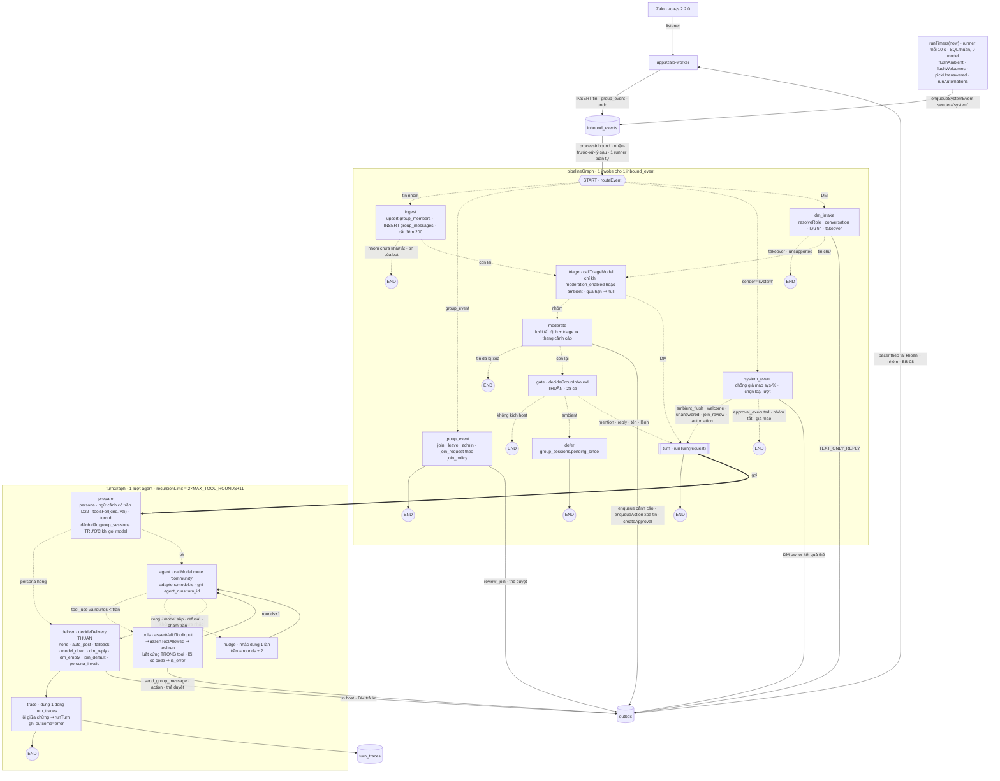

# 00 — KIẾN TRÚC & BẤT BIẾN · Agent chăm sóc cộng đồng Zalo

> **Trạng thái:** hợp đồng kiến trúc, khoá cho vòng `0.1.x` (phát hành đầu tiên — D11).
> **Nguồn chân lý cấp trên:** [`../plan.md`](../plan.md) §2 (D01–D11 của Super Orchestrator, D12–D20 của architect). Mâu thuẫn ⇒ `plan.md` thắng, rồi file này, rồi `01-CONTRACTS.md`, rồi SPEC-P từng gói, rồi `docs/`.
> **Người đọc mục tiêu:** worker KHÔNG có lịch sử hội thoại. Mọi tên hàm/bảng/lệnh trong bộ SPEC này đã được đối chiếu với mã thật tại HEAD `eada365` ngày 2026-10-09 (xem §9).
> **D28 (2026-10-16, architect H04):** runtime agent là ĐỒ THỊ LangGraph.js (`@langchain/langgraph` 1.4.18, pin chính xác): `pipelineGraph` (một sự kiện vào) + `turnGraph` (một lượt agent). §4 sơ đồ mới (Mermaid + ASCII), §5 thành phần, §6 cột "Node hiện thực" + BB-15…BB-17, §7 vùng cấm hệ LangChain. Hợp đồng đồ thị: [01-CONTRACTS §12](01-CONTRACTS.md); hành vi: [SPEC-P03 §2, §6](SPEC-P03-Runtime-Agent.md). Đo: `evidence/ARCH-D28/{versions,spike}.txt`.

## §1. Router thứ tự đọc

| # | File | Đọc khi nào | Bỏ qua được |
| :-- | :-- | :-- | :-- |
| 1 | `00-ARCHITECTURE.md` (file này) | Luôn luôn | ❌ |
| 2 | [`01-CONTRACTS.md`](01-CONTRACTS.md) | Trước khi viết bất kỳ type/DDL/tool/API | ❌ |
| 3 | [`SPEC-P01-Go-San-Tho.md`](SPEC-P01-Go-San-Tho.md) | Gói đầu tiên — gỡ mã sàn thợ, migration 007/008 | chỉ khi P01 đã ✅ |
| 4 | [`SPEC-P02-Transport-Nhom.md`](SPEC-P02-Transport-Nhom.md) | Mọi thứ nhận/gửi Zalo nhóm, hành động quản trị, kênh giả lập nhóm | ✅ |
| 5 | [`SPEC-P03-Runtime-Agent.md`](SPEC-P03-Runtime-Agent.md) | Đồ thị pipeline + đồ thị lượt (D28), cổng nhận tin, phiên, đệm, persona, chính sách tool | ❌ (mọi gói agent đọc) |
| 6 | [`SPEC-P04-Tri-Thuc.md`](SPEC-P04-Tri-Thuc.md) | Kho tri thức, truy hồi lai, trích dẫn, câu hỏi bỏ trống | ✅ |
| 7 | [`SPEC-P05-Kiem-Duyet.md`](SPEC-P05-Kiem-Duyet.md) | Kiểm duyệt, thang cảnh cáo, thẻ duyệt, duyệt vào nhóm, chào mừng | ✅ |
| 8 | [`SPEC-P06-Lead-Tri-Nho.md`](SPEC-P06-Lead-Tri-Nho.md) | Kéo sang 1-1, thẻ lead, hồ sơ thành viên, ghi chú ngày | ✅ |
| 9 | [`SPEC-P07-Lich-Van-Hanh.md`](SPEC-P07-Lich-Van-Hanh.md) | Lịch (`automations`), bình chọn/nhắc/ghi chú, tóm tắt tuần, báo cáo ngày | ✅ |
| 10 | [`SPEC-P08-Dashboard.md`](SPEC-P08-Dashboard.md) | Mọi trang/route web mới | ✅ |
| 11 | [`OPERATIONS.md`](OPERATIONS.md) | Trước lần chạy Zalo thật đầu tiên và trước deploy VPS | ❌ |
| 12 | [`TESTING-ACCEPTANCE.md`](TESTING-ACCEPTANCE.md) | Trước khi báo "xong" bất kỳ gói nào | ❌ |

## §2. Mục tiêu (D01, D05)

Một tài khoản Zalo cá nhân (`community`) làm **phó nhóm** trong các nhóm Zalo của cộng đồng quan tâm AI agent / muốn dựng AI chăm sóc khách hàng. Agent:

1. **Hỏi đáp** khi được gọi (mention / trả lời tin bot / gọi tên) và **nhặt câu hỏi bị bỏ trống** quá `UNANSWERED_AFTER_MIN` phút ở nhóm chế độ `ambient`; trả lời **có trích dẫn** từ kho tri thức cộng đồng.
2. **Chào thành viên mới** bằng lời do agent soạn (không chỉ template) và **duyệt yêu cầu vào nhóm** theo chính sách từng nhóm.
3. **Kiểm duyệt:** phân loại spam / lừa đảo / quảng cáo bằng **model + lưới tất định chính xác cao**, thang cảnh cáo theo (nhóm, người) có suy giảm, **xoá tin người khác** (sửa đúng lỗi `uidFrom` của zaloclaw), đề nghị kick/block qua **thẻ duyệt**.
4. **Kéo việc riêng sang 1-1**, **thu thập & sàng lọc khách tiềm năng** muốn setup AI CSKH ⇒ thẻ lead trên dashboard ⇒ chuyển chủ.
5. **Vận hành nhóm:** thông báo, bình chọn, nhắc lịch, ghi chú, tóm tắt tuần; **báo cáo ngày** cho chủ qua DM.
6. **Tự giới thiệu năng lực** khi được hỏi — agent là bản demo sống của sản phẩm.

Số đo thành công vòng 0.1 (TESTING §4): golden thật với model thật (D10) đạt ngưỡng; 7 ngày chạy Zalo thật trong ≥ 2 nhóm không bị khoá tài khoản, 0 hành động quản trị nguy hiểm ngoài thẻ duyệt.

## §3. Non-goals (vòng 0.1)

| Không làm | Lý do / quyết định |
| :-- | :-- |
| Sàn việc thợ, cư dân, BQL, slot, ticket, access pass | D01 — bỏ hẳn; mã gỡ ở P01, tag `archive/plan-01-marketplace` |
| Marketing / FOMO / chiến dịch kéo thành viên | D05 — ngoài phạm vi |
| Nhiều tài khoản Zalo | D12 — một tài khoản `community` ở 0.1; tài khoản doanh nghiệp là giai đoạn sau (D25); đường nối tenant có sẵn (D23) |
| Zalo OA, lớp `ChannelAdapter` | D25 — chỉ zca-js; BB-02/BB-03 đã nhốt zca-js trong worker |
| Nhiều tenant thật (RLS, dashboard lọc tenant) | D23 — 0.1 chỉ có tenant `default`; bảng + cột có sẵn |
| Tin ảnh/file/voice vào agent (chỉ ghi nhận loại tin) | D12 — rủi ro tải file + bộ nhớ; Idea Vault |
| Gửi file theo đường dẫn, `exec`, đọc file hệ thống, tự cập nhật (`git pull`), restart từ chat | Vùng cấm §7 — lỗi zaloclaw không lặp lại |
| Giải tán nhóm, đổi chủ nhóm, thêm/bớt admin từ agent | D06 — KHÔNG TỒN TẠI dưới dạng tool |
| Lọc prompt-injection bằng regex | D05(c) — cộng đồng AI bàn prompt công khai; chống leo thang bằng chính sách tool theo vai |
| Lịch dạng `cron` | D16 — chỉ `at`/`every`/`daily`/`weekly` (không thêm thư viện); cron khi có nhu cầu |
| pg-boss, hàng đợi ngoài Postgres | Giữ Đ22/Đ27 của kế hoạch 01: một runner tuần tự + `runTimers(now)` |
| Thanh toán, hợp đồng với lead | Lead chỉ tới thẻ "chuyển chủ" |

## §4. Luồng chuẩn — pipeline là ĐỒ THỊ LangGraph (D28)

> Sơ đồ này là HỢP ĐỒNG: tên node/cạnh khớp 1-1 với [01-CONTRACTS §12.4](01-CONTRACTS.md) và được test `graph-shape.test.ts` so với `getGraph()` của mã thật (BB-16). Đổi sơ đồ ⇒ D mới + người dùng duyệt lại.
> Hai đồ thị, KHÔNG lồng state: `pipelineGraph` xử lý MỘT `inbound_events` (một `invoke`, rồi state bị bỏ — BB-17); node `turn` của nó gọi `runTurn()` ⇒ `turnGraph` chạy MỘT lượt agent. Cạnh nét đứt = cạnh điều kiện (hàm THUẦN của state, `graph/edges.ts`). Hình trụ = bảng Postgres.

### §4.1 Mermaid



### §4.2 Bản ASCII (cùng nội dung, cho terminal)

```text
Zalo (zca-js 2.2.0) ─listener─► apps/zalo-worker ─INSERT─► [inbound_events] ◄─enqueueSystemEvent(sender='system')─ runTimers(now)
                                                                │                (SQL thuần, 0 model: flushAmbient · flushWelcomes ·
                                                                │                 pickUnanswered · runAutomations)
                              processInbound (nhận-trước-xử-lý-sau, 1 runner) ▼
┌─ pipelineGraph (1 invoke / 1 inbound_event; ┄► = cạnh điều kiện THUẦN) ─────────────────────────────────────────────────┐
│ START ┄routeEvent┄┬┄ tin nhóm ┄► ingest ┄┬┄ nhóm chưa khai/tắt · tin bot ┄► END                                           │
│                   │                      └┄► triage ┄┬┄ nhóm ┄► moderate ┄┬┄ tin đã xoá ┄► END                            │
│                   │                                  │                    └┄► gate ┄┬┄ không kích hoạt ┄► END              │
│                   │                                  │                              ├┄ ambient ┄► defer ─► END            │
│                   │                                  │                              └┄ mention/reply/tên/lệnh ┄► turn     │
│                   │                                  └┄ DM ┄► turn                                                          │
│                   ├┄ group_event ┄► group_event ─► END                                                                      │
│                   ├┄ sender=system ┄► system_event ┄┬┄ ambient_flush/welcome/unanswered/join_review/automation ┄► turn    │
│                   │                                 └┄ approval_executed · nhóm tắt · giả mạo ┄► END                         │
│                   └┄ DM ┄► dm_intake ┄┬┄ takeover · unsupported ┄► END                                                     │
│                                       └┄ tin chữ ┄► triage (như trên, nhánh DM)                                            │
│ turn ─► END            (turn = runTurn(request) ⇒ turnGraph bên dưới)                                                      │
└──────────────────────────────────────────────────────────────────────────────────────────────────────────────────────────┘
┌─ turnGraph (1 lượt; recursionLimit = 2×MAX_TOOL_ROUNDS + 11) ─────────────────────────────────────────────────────────────┐
│ START ─► prepare ┄┬┄ persona hỏng ┄► deliver                                                                                │
│                   └┄ ok ┄► agent ┄┬┄ tool_use ∧ rounds < trần ┄► tools ─(rounds+1)─► agent                                │
│                                   ├┄ mustReply ∧ chưa nói ∧ không text ∧ chưa nhắc ┄► nudge ─(trần = rounds+2)─► agent    │
│                                   └┄ xong · model sập · refusal · chạm trần ┄► deliver ─► trace ─► END                    │
└──────────────────────────────────────────────────────────────────────────────────────────────────────────────────────────┘
Ghi outbox (chỉ qua enqueue()/enqueueAction() — BB-02, BB-15): moderate · group_event · system_event · dm_intake (TEXT_ONLY_REPLY)
  · tools · deliver.  KHÔNG ghi outbox: ingest · triage · gate · defer · prepare · agent · nudge · trace.
Gọi model: CHỈ agent (callModel) và triage (callTriageModel) — qua adapters/model.ts (BB-03).
Ghi DB chính: ingest→group_members/group_messages · triage→group_messages.is_question/messages.triage · moderate→moderation_* /approvals
  · defer/prepare→group_sessions · dm_intake→conversations/messages · tools→theo tool · deliver→messages/audit · trace→turn_traces.
[outbox] ─pacer theo tài khoản + theo nhóm (BB-08)─► apps/zalo-worker ─► zca-js
apps/web: dashboard (nhóm, persona có phiên bản, thẻ duyệt, lead, kiểm duyệt, tri thức, lịch, /agent đọc turn_traces) + /zalo + /dev/sim
```

## §5. Thành phần (giữ nền D02)

```text
apps/zalo-worker    zca-js 2.2.0 (pin), MỘT tài khoản `community`, phiên mã hoá AES-GCM, QR qua web,
                    listener message/group_event/undo/closed/error, outbox pacer (text + action), watchdog
packages/core       adapters/{db,model,transport} · agent/community/* (graph/* = đồ thị D28) · services/* · retrieval/* · sim/* · runner
                    + @langchain/langgraph 1.4.18 và peer @langchain/core 1.2.14 — PIN CHÍNH XÁC (không ^), chỉ dùng
                      Annotation/StateGraph/START/END/GraphRecursionError (01-CONTRACTS §12.1); phát hành ≥ 14 ngày,
                      chạy được Node 22.20.0 (evidence/ARCH-D28/versions.txt, spike.txt)
apps/web            Next.js 15: auth 2 vai (admin, operator), dashboard §4, /zalo, /dev/sim (nhóm)
Postgres 16 + pgvector 0.8.5 (đo 2026-10-09), Docker; migration append-only 007, 008, 009 (D23/D24) — LangGraph KHÔNG thêm bảng (BB-17)
```

## §6. Bất biến (BẮT BUỘC — mọi gói)

D28: mọi BB cũ GIỮ NGUYÊN nghĩa; cột "Node hiện thực" chỉ nơi đặt mã trong đồ thị (01-CONTRACTS §12.3). Thêm BB-15…BB-17 cho chính đồ thị.

| Mã | Bất biến | Node hiện thực (D28) | Cách canh |
| :-- | :-- | :-- | :-- |
| BB-01 | Agent thực hiện MỌI việc qua tool; luật cứng nằm TRONG tool (kiểm vai, ngân sách, trạng thái) và tool từ chối bằng lỗi có kiểu (01-CONTRACTS §9). Agent không có tool ngoài danh sách 01-CONTRACTS §7 | `prepare` (`toolsFor` lọc `tools[]`) · `tools` (`assertValidToolInput` ⇒ `assertToolAllowed` ⇒ `tool.run`; lỗi có `code` ⇒ `is_error`) | `scripts/check_agent_tools.mjs` (bản mới, SPEC-P01 §6) quét tên tool cấm + đối chiếu danh sách |
| BB-02 | Mọi lời nói/hành động ra Zalo đi qua `outbox` bằng `enqueue()` của `adapters/transport.ts`; CẤM gọi zca-js ngoài `apps/zalo-worker` | node có cột "outbox ✓" ở 01-CONTRACTS §12.3 (`moderate`, `group_event`, `system_event`, `dm_intake`, `tools`, `deliver`) — luôn qua `enqueue`/`enqueueAction` | `scripts/check_adapter_boundary.mjs` (giữ nguyên + luật BB-15) |
| BB-03 | Chỉ `adapters/db.ts` mở Postgres, chỉ `adapters/model.ts` gọi LLM/embedding (Gemini mặc định — Đ18 cũ giữ), chỉ `adapters/transport.ts` ghi outbox | `agent` gọi `callModel`, `triage` gọi `callTriageModel` — đều qua adapter; KHÔNG ChatModel LangChain, KHÔNG checkpointer mở pool riêng (§7) | `check_adapter_boundary` |
| BB-04 | Danh tính & vai (`owner`/`moderator`/`member`/`stranger`) lấy từ `account_owners` + `group_members`, KHÔNG BAO GIỜ từ nội dung tin, tên hiển thị hay output model | `ingest` (upsert `group_members` TRƯỚC `resolveRole`) · `dm_intake` (`resolveRole`) · `gate` | test giả mạo `[userId: …]`, `@Tên` (SPEC-P03 §3 ca G24/G25) |
| BB-05 | Ở nhóm, agent chỉ lên tiếng bằng tool `send_group_message`; text cuối của lượt `ambient` là RIÊNG TƯ (không đăng). Lượt `mention`/`reply_to_bot`/`name_pattern`/`owner_command` BẮT BUỘC có một tin ra (host thi hành, SPEC-P03 §6.4) | cạnh `afterAgent` + `needsNudge` + `decideDelivery` (THUẦN) · node `nudge` · node `deliver` | test lượt ambient không gọi tool ⇒ 0 outbox; lượt mention không gọi tool ⇒ 1 outbox fallback; bảng `decideDelivery` (SPEC-P03 §6.5) |
| BB-06 | Hành động nguy hiểm (kick, block, từ chối vào nhóm khi policy `manual`, thông báo toàn nhóm do agent tự đề xuất) chỉ TẠO `approvals`; thi hành chỉ sau khi owner/moderator/staff duyệt. `disperse_group`, `change_group_owner`, `add/remove_group_deputy`, `self_update`, `restart`, `send_file`, `exec` KHÔNG TỒN TẠI dưới dạng tool hay action outbox | `tools` (`request_member_removal`) · `moderate` (`kick_requested`/`block_requested` ⇒ `createApproval`) · `group_event` (policy `manual`) | `check_agent_tools` cấm tên; `outbox.body.action` enum 01-CONTRACTS §8.3 |
| BB-07 | Hồ sơ thành viên (`member_profiles`) và ghi chú ngày (`daily_notes`) KHÔNG BAO GIỜ được nạp vào lượt nhóm; lượt nhóm chỉ thấy persona + kho tri thức công khai + đệm nhóm | `prepare` (nhánh nhóm không đọc 2 bảng này) | test prompt nhóm không chứa chuỗi từ `member_profiles.notes` |
| BB-08 | Ngân sách phát ngôn: ≤ `zalo_groups.budget_per_hour` tin text/nhóm/giờ, ≤ `PACER_MAX_PER_MINUTE` tin/tài khoản/phút, khoảng cách ≥ `PACER_GROUP_GAP_MS` + jitter giữa 2 tin cùng nhóm; chunk ≤ `PACER_MAX_CHARS` (1800 < 2000) | ngoài đồ thị: pacer worker; trong đồ thị: tool `send_group_message` (`GroupBudgetExceededError`) | `budget-ref` (evidence/ARCH) + test pacer worker |
| BB-09 | Mọi hành động quản trị (xoá tin, cảnh cáo, duyệt vào nhóm, kick/block, đổi chế độ nhóm, đổi persona) ghi `audit_log` với actor | `moderate` · `group_event` · `tools` · `deliver` | test đếm audit = đếm hành động |
| BB-10 | Tên nhóm, tên thành viên, nội dung quote, nội dung tin là DỮ LIỆU KHÔNG TIN CẬY — rào bằng khung `<<<untrusted …>>>` khi nạp vào model; CẤM nối chuỗi `[uid, name]: body` không thoát (lỗi zaloclaw `monitor.ts:931`) | `prepare` (dựng message `user`) · `triage` (prompt triage) | test prompt có khung + ca injection (SPEC-P03 §8) |
| BB-11 | Đệm nhóm giữ ≤ `GROUP_BUFFER_MAX` (200) tin/nhóm và ≤ `GROUP_BUFFER_RETENTION_DAYS` (7) ngày; `group_messages` lưu `sender_uid` + `cli_msg_id` cho mọi tin (kể cả tin bot) | `ingest` (+ `runTimers.pruneBuffers` ngoài đồ thị) | `db-checks` (a) evidence/ARCH |
| BB-12 | Model hiểu ý, code là lưới tất định chính xác cao (kế hoạch 01 Đ21 giữ): mọi quyết định "có phải spam", "có muốn setup", "có hỏi không" là model + lưới; CẤM regex là cơ chế chính, CẤM regex "injection guard" | `triage` (model) + `moderate` (lưới) · `gate` chỉ kiểm cấu trúc (mention/quote/tên/lệnh), không đoán ý | review prompt/golden |
| BB-13 | Ngữ cảnh có trần (D22): lượt DM nạp ≤ `2 × DM_HISTORY_TURNS` tin gần nhất + ghi chú thành viên của chính người nhắn + tóm tắt lead mở — KHÔNG nhiều hơn; lượt nhóm theo SPEC-P03 §4.2 (25/40 tin). `messages` giữ ≤ `MESSAGES_RETENTION_DAYS` ngày. CẤM nén/tóm tắt hội thoại bằng model | `prepare` (nguồn DUY NHẤT của ngữ cảnh; state `messages` bắt đầu rỗng mỗi lượt) + BB-17 (không checkpointer ⇒ không lịch sử tích luỹ) | test body fetch giả lượt DM (SPEC-P03 §11 hàng 5m) + G21 |
| BB-14 | Mỗi lượt agent ghi đúng 1 dòng `turn_traces`, không chứa nội dung tin/prompt (D24) | `trace` (đường thường) · `runTurn` (node ném lỗi trước `trace` ⇒ ghi `outcome='error'` đúng 1 lần) | test DB SPEC-P03 §11 hàng 5n, 5q + G21 |
| BB-15 | (D28) Mỗi node chỉ có tác dụng phụ ghi trong bảng 01-CONTRACTS §12.3: node cột "outbox ✗" KHÔNG import `adapters/transport`, `services/outbox-actions`, `services/approvals`; CHỈ `nodes/agent.ts` gọi `callModel`, CHỈ `nodes/triage.ts` gọi `triageCommunityMessage`; model KHÔNG BAO GIỜ tự ghi outbox — mọi tin ra là kết quả của tool hoặc của `deliver` | toàn bộ `agent/community/graph/nodes/*` | `check_adapter_boundary.mjs` mở rộng (SPEC-P03 §11 hàng 12) + bằng chứng đỏ |
| BB-16 | (D28) Mọi cạnh điều kiện và quyết định kết thúc lượt (`routeEvent`, `after*`, `needsTriage`, `needsNudge`, `isCapped`, `decideDelivery`, `hostText`) là hàm THUẦN của state trong `graph/edges.ts` (không I/O, không `Date.now()`, không model); mọi `addConditionalEdges` khai danh sách đích tường minh; hình hai đồ thị (node + cạnh) khớp ĐÚNG hằng `PIPELINE_SHAPE`/`TURN_SHAPE` = 01-CONTRACTS §12.4 = sơ đồ §4 đã duyệt | `graph/edges.ts`, `graph/pipeline.ts`, `graph/turn.ts` | `edges.test.ts` (bảng ca) + `graph-shape.test.ts` (so `getGraph()` với hằng) |
| BB-17 | (D28) Đồ thị KHÔNG giữ trạng thái và KHÔNG gửi dữ liệu ra ngoài: không checkpointer/Store/`interrupt`; mỗi `inbound_events` một `invoke` mới với state rỗng, state bị bỏ khi xong; nguồn chân lý là bảng Postgres (`inbound_events`, `group_sessions`, `messages`, `approvals`, `turn_traces`…); không LangSmith/LangGraph Platform — `LANGSMITH_TRACING`/`LANGCHAIN_TRACING_V2` bật ⇒ `ConfigError` lúc khởi động | `pipeline.ts`, `turn.ts` (compile không checkpointer) · `services/community-config.ts` | grep cấm trong `check_adapter_boundary` (SPEC-P03 §11 hàng 12) + `community-config.test.ts` (hàng 11) |

## §7. Vùng cấm (đã cân nhắc, quyết KHÔNG làm — kèm lý do)

- **Mega-tool nhiều `action`** (zaloclaw `tool.ts:136-309`, 153 action, ~4k token/lượt, không phân quyền được) — mỗi tool một việc, mỗi tool tự kiểm vai.
- **`delete-message` với `uidFrom = chính bot`** (zaloclaw `tool.ts:741`): không xoá được tin người khác. Ta lưu `sender_uid` + `cli_msg_id` trong `group_messages` và truyền đúng `uidFrom` của người gửi (SPEC-P02 §4.2).
- **Tool `self-update`/`restart-channel`/`disperse-group`/`change-group-owner`** (zaloclaw `tool.ts:483-499`, `1081-1096`, `2023-2031`): không tồn tại.
- **Gửi file theo đường dẫn cục bộ** (zaloclaw `tool.ts:621-642` `send-file`, `validateLocalFilePath`): rò file hệ thống — không có tool gửi file.
- **Regex "injection guard" tự động chặn/kick** (zaloclaw `injection-guard.ts:31-57`, `autoRemove`): báo nhầm hàng loạt trong cộng đồng AI; bảo mật bằng BB-04/BB-06/BB-07, không bằng từ khoá.
- **Nối sender vào body không rào** (zaloclaw `monitor.ts:931` `[userId: ${senderId}, name: ${name}]: ${rawBody}`) — giả mạo danh tính bằng text; ta rào `<<<untrusted>>>` và danh tính chỉ từ DB.
- **Chỉ nhận mention gốc, bỏ quote/tên bot** (zaloclaw `monitor.ts:850-877`): ta có 4 cách kích hoạt + `ambient` (OpenClaw `mention-gating.ts:88-117`).
- **Đệm nhóm trong RAM 50 tin/4 giờ** (zaloclaw `monitor.ts:66-80`): mất khi restart ⇒ đệm trong Postgres (BB-11).
- **Lưu TOÀN BỘ lịch sử nhóm vĩnh viễn ra JSONL** (zaloclaw `passive-collector.ts`): rủi ro Luật 91/2025 ⇒ đệm vòng + hạn 7 ngày; không có tool "recall toàn bộ lịch sử".
- **Sự kiện nhóm chỉ template, bỏ qua groupPolicy** (zaloclaw `group-event.ts`): ta cho agent soạn lời chào, có qua `enabled`/policy nhóm; template chỉ là đường lùi khi model sập.
- **Không pacing/jitter khi gửi** (zaloclaw `send.ts`): giữ outbox pacer + ngân sách nhóm (BB-08).
- **Mở mặc định (`dmPolicy`/`groupPolicy = open`** — zaloclaw `monitor.ts:713,738`): mặc định ta là allowlist — nhóm chưa khai trong `zalo_groups` thì KHÔNG đệm, KHÔNG trả lời.
- **Config ghi file không atomic, credentials rõ, một zca instance toàn cục** (zaloclaw): ta giữ cấu hình trong Postgres, phiên AES-GCM (P02 cũ), `AccountSession` theo tài khoản.
- **Tự xin QR mới khi hết hạn, tự đăng nhập lại sau 3000/3003** — giữ nguyên luật kế hoạch 01 (G01).
- **Kết bạn/nhắn chủ động người lạ**: agent chỉ DM người đã nhắn bot trước HOẶC là thành viên nhóm đang được mời "nhắn riêng" (SPEC-P06 §2) và tuân pacer `maxRecipients`.
- **Chấm golden bằng model không dùng thật** (Đ26 cũ): gate chấm bằng `gemini-3.6-flash`.
- **Tiêm hồ sơ thành viên / ghi chú ngày vào nhóm** (OpenClaw: MEMORY never injected in group sessions) — BB-07.
- **Sửa migration 001–006**: append-only; 007/008 đã được architect áp thử từ rỗng (`evidence/ARCH/migration-probe.txt`). Thay đổi sau ngày duyệt đi vào file MỚI (009), không sửa 007/008.
- **Nén hội thoại (compaction) / tóm tắt phiên bằng model / nạp toàn bộ lịch sử DM** (D22): token mỗi lượt tăng theo độ dài hội thoại và mỗi lần nén là thêm một lời gọi model; khách quay lại chỉ cần 5 lượt gần nhất + ghi chú. Trí nhớ dài = `remember_member_note` có chủ đích + trường lead.
- **`tenant_id` trên mọi bảng** (D23): các bảng 008 đã khoá theo `zalo_account_id`; tenant suy qua `zalo_accounts.tenant_id` — một nguồn chân lý.
- **Zalo OA / lớp `ChannelAdapter` trừu tượng** (D25): người dùng chỉ dùng zca-js; ranh giới worker ↔ `inbound_events`/`outbox` đã là đường nối kênh.

**Vùng cấm hệ LangChain/LangGraph (D28 — đã cân nhắc, quyết KHÔNG dùng; muốn dùng ⇒ D mới):**
- **ChatModel của LangChain** (`@langchain/google-genai`, `@langchain/openai`, `@langchain/anthropic`, `initChatModel`, `bindTools`): BB-03 — `adapters/model.ts` đã dịch Gemini/OpenRouter/Vyce, `thoughtSignature`, fallback `MODEL_FALLBACKS`, ghi `agent_runs`; hai đường gọi model = hai nguồn chân lý về chi phí/token và mất test adapter hiện có.
- **Agent dựng sẵn** (`createReactAgent`, `createAgent`, `ToolNode`, `toolsCondition`, `@langchain/langgraph/prebuilt`): đòi tool dạng LangChain + `BaseMessage`; không có chỗ cho `mustReply`/`nudge`/`deliver`, lọc `tools[]` theo vai TRƯỚC khi gọi model, lỗi có `code`, mọi `tool_result` trong MỘT message. Node `agent` + `tools` của ta là vài chục dòng (spike A–J).
- **`MessagesAnnotation` / `addMessages` / `messagesStateReducer` / `BaseMessage`**: đổi `MessageParam` dạng Anthropic (hợp đồng adapter) sang lớp LangChain. State giữ `MessageParam[]` với reducer nối mảng thường (spike A: messages ra khỏi đồ thị vẫn là object thuần đúng thứ tự vai).
- **Checkpointer (`MemorySaver`, `PostgresSaver`, `@langchain/langgraph-checkpoint-*`), `Store`, `interrupt`/human-in-the-loop, time-travel**: đo trên DB tạm (`evidence/ARCH-D28/spike.txt`): `setup()` tự tạo 4 bảng ngoài `db/migrations` (`checkpoint_blobs/_migrations/_writes`, `checkpoints`); 2 lượt ngắn ⇒ 16 checkpoint · 64 blob · 50 write; chuỗi SĐT giả trong tin bị lưu nguyên văn (10 blob + 2 write); cùng `thread_id` ⇒ lượt 2 kế thừa lịch sử lượt 1 (4 ⇒ 8 messages). Trái BB-03 (pool riêng), BB-13/D22 (lịch sử tích luỹ), D24/Luật 91 (nội dung tin ngoài hạn giữ), luật migration append-only. Duyệt thẻ đã có `approvals` + sự kiện hệ thống (TTL 24 giờ) — không treo đồ thị chờ người.
- **LangSmith / LangGraph Platform / Studio / `langgraph-cli` server**: đo: bật `LANGSMITH_TRACING=true` ⇒ thư viện TỰ gọi `GET /info` + `POST /runs/multipart` (không bật ⇒ 0 lần gọi mạng). Dữ liệu cộng đồng ra dịch vụ ngoài + chi phí ⇒ BB-17 chặn bằng `ConfigError`. Quan sát lượt = `turn_traces` + `agent_runs` + dashboard `/agent` (D24).
- **`Send`/fan-out, chạy tool song song, nhiều node cùng ghi một kênh state trong một bước**: tool có ngân sách, đếm `answered`, thứ tự quan trọng; runner MỘT bản tuần tự (Đ22 cũ).
- **State khai bằng zod (`StateSchema`, `MessagesZodState`)**: hai cách khai state trong một repo; `Annotation.Root` đủ và đã đo.
- **Đưa `runTimers` hay lịch vào trong đồ thị** (cron/loop của LangGraph): timers giữ SQL thuần 0 model (D08) và vào đồ thị bằng `inbound_events sender='system'` — một cửa vào duy nhất.
- **Phiên bản nổi (`^`, `~`) cho `@langchain/*`**: pin chính xác + `overrides` gói bắc cầu (01-CONTRACTS §12.1); nâng = quy trình như zca-js (OPERATIONS §8).
- **Để `recursionLimit` mặc định (25)**: đo: lượt xấu nhất cần 2×8+10 = 26 super-step ⇒ mặc định ném `GraphRecursionError`; đặt `recursionLimit` = số step đúng bằng 26 VẪN ném (dù node cuối đã chạy) ⇒ trần BẮT BUỘC = `2 × MAX_TOOL_ROUNDS + 11` (spike J1, J1b, J2).

## §8. Tái sử dụng từ kế hoạch 01 (PORT, không copy mù)

| Thứ | File gốc (HEAD `eada365`) | Dùng ở |
| :-- | :-- | :-- |
| Luật vòng tool (≤N vòng, kiểm input schema, `tool_result` một message, lỗi có `code`) — D28: chỉ port LUẬT vào node `agent`/`tools`, KHÔNG port vòng `for` (vòng = cạnh `tools → agent` của `turnGraph`) | `packages/core/src/agent/resident-agent.ts:135-269` (đọc từ tag `archive/plan-01-marketplace`) | SPEC-P03 §6 |
| Lớp hiểu ý JSON, quá hạn ⇒ `null`, không retry | `packages/core/src/agent/triage.ts`, `adapters/model.ts::callTriageModel` | SPEC-P03 §5, SPEC-P05 §3 |
| Bằng chứng ý định tất định trong tool (`IntentNotConfirmedError`) | `packages/core/src/agent/tools/claim_job.ts` (đọc trước khi xoá) | `decide_approval` (SPEC-P05 §5.4) |
| Sự kiện hệ thống trên `inbound_events` (`sender_uid='system'`) | `packages/core/src/services/system-events.ts` | SPEC-P03 §4.3 |
| `runTimers(now)` tham số hoá, mỗi bước idempotent | `packages/core/src/services/timers.ts` | SPEC-P07 §2 |
| Pacer thuần + `verifySendLog` + `simulatePacer` | `apps/zalo-worker/src/pacer-policy.ts` | SPEC-P02 §5 |
| Truy hồi từ khoá an toàn (`buildQueryTokens` chỉ `[a-z0-9]`, N14) | `packages/core/src/retrieval/search-regulations.ts:45-63` | SPEC-P04 §2 |
| `immutable_unaccent` + tsv generated | `db/migrations/002_search.sql` | 008 (`daily_notes.tsv`) |
| Che SĐT trước model (`PHONE_RE`) | `packages/core/src/agent/pii.ts:137` | SPEC-P03 §5.3 |
| SimTransport nhận-trước-xử-lý-sau | `packages/core/src/sim/sim-transport.ts::processInbound` | giữ nguyên |
| Máy chấm golden: `blocked` khi thiếu credential / >10% lỗi hạ tầng, exit 0/1/3 | `scripts/eval/score.mjs`, `eval_golden.mjs` | TESTING §3 |

Mẫu OpenClaw/zaloclaw (MIT) chỉ được port theo mô tả trong SPEC; nếu chép nguyên đoạn mã nào thì ghi vào `THIRD_PARTY_NOTICES.md` (SPEC-P01 §7).

## §9. Số đo nền đã đo (2026-10-09, HEAD `eada365`)

| Số | Giá trị | Lệnh |
| :-- | :-- | :-- |
| Unit test hiện có | 317 (core 244, web 36, worker 37) | `npm test -w @lenqclaw/core` … (TESTING §1) |
| Test DB hiện có | 196 (kernel) — sẽ giảm mạnh ở P01 vì xoá test sàn thợ | `npm run test:db` |
| Migration áp trên DB dev | 001–004 (005, 006 chưa áp trên DB dev; `test:db` tự áp) | `select version from schema_migrations` |
| Constraint thật | `zalo_accounts_id_check`, `outbox_kind_check`, `staff_users_role_check`, `staff_users_building_id_fkey`, `kb_documents_building_id_fkey` | `evidence/ARCH/migration-probe.txt` |
| DDL 007+008 | áp từ rỗng sau 001–006: `applied 2`, chạy lại `applied 0`, 27 bảng, 21/21 kiểm OK | `evidence/ARCH/migration-probe.txt` |
| Cổng nhận tin tham chiếu | 28/28 ca | `evidence/ARCH/gate-ref.txt` |
| Thang cảnh cáo tham chiếu | 14/14 ca (sau khi chốt làm tròn 1 chữ số thập phân) | `evidence/ARCH/ladder-ref.txt` |
| Ngân sách nhóm | 100 tin ⇒ 20 tin/giờ đầu, khoảng cách tối thiểu 9000 ms, mọi cửa sổ ≤ 20 | `evidence/ARCH/budget-ref.txt` |
| SQL đệm/câu hỏi/ngân sách/ambient | 5/5 OK | `evidence/ARCH/db-checks.txt` |
| (D28, 2026-10-16) Phiên bản LangGraph | `@langchain/langgraph` 1.4.18 (2026-09-25) · `@langchain/core` 1.2.14 (2026-10-01); 45 gói trong cây cài, `too_new=0` (mọi gói ≥ 14 ngày) | `evidence/ARCH-D28/versions.txt` |
| (D28) Spike đồ thị lượt + pipeline (Node 22.20.0, model giả, 0 mạng) | `tsc` strict exit 0; 18/18 PASS: dừng đúng 8 vòng/9 lời gọi model, nudge 1 lần, auto_post, fallback, model_down, refusal, trace lỗi đúng 1 dòng, `recursionLimit` 2M+11; checkpointer 3/3 (lý do cấm); LangSmith off 0 gọi mạng / on 2 | `evidence/ARCH-D28/spike.txt` |
